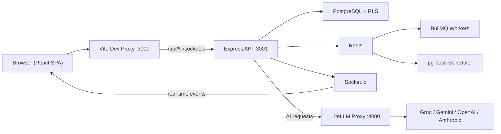
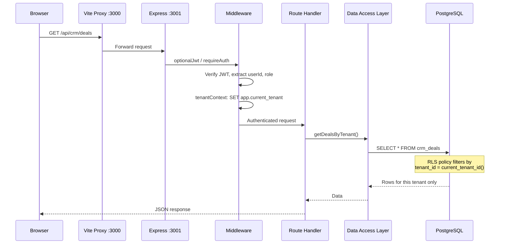
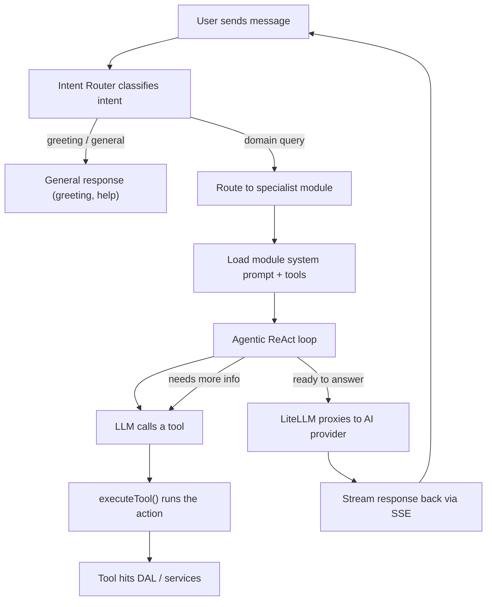

# Architecture

This document explains how Messign Workspace is built, how the pieces connect, and where the important code lives. It is written for someone who is joining the project or returning to it after a break.

## High-Level Overview



**In plain English:** the React app in your browser talks to the Express API through a Vite dev proxy. The API reads and writes data in PostgreSQL (with row-level security enforcing tenant isolation), pushes real-time updates through Socket.io, offloads heavy work to BullMQ/pg-boss job queues backed by Redis, and sends AI requests through a LiteLLM proxy that routes to whichever model provider is configured.

---

## Folder Structure

### Root

```
messign-workspace/
  client/               # React SPA (Vite + TypeScript + Tailwind)
  server/               # Express API (TypeScript)
  db/                   # RLS enforcement scripts, app role setup
  litellm/              # LiteLLM proxy config (model routing, fallbacks)
  docs/                 # PRD, roadmap, architecture notes, deployment guides
  e2e/                  # Playwright end-to-end tests
  scripts/              # Build helpers, port cleanup, logo rendering
  deploy/               # PgBouncer config and deployment scripts
  assets/               # Branding files (logos)
  package.json          # npm workspaces root (client + server)
```

### Client (`client/src/`)

```
src/
  App.tsx               # Top-level routing (public, admin, authenticated shell)
  main.tsx              # Vite entry point

  pages/                # Page-level views, organized by domain
    marketing/          #   Marketing hub, email builder, campaigns, content calendar
    finance/            #   Expenses, invoices, budgets, accounting, vendors
    crm/                #   Pipeline, contacts, companies, forecast
    knowledge-hub/      #   Documents, AI search, collections, bookmarks
    recruitment/        #   Jobs, candidates, pipeline, interviews
    support/            #   Tickets, SLA policies, categories
    executive/          #   Executive dashboard
    culture/            #   Culture pulse surveys
    okr/                #   OKR goal tracking
    time/               #   Time tracking and timesheets
    dora/               #   Daily briefing, automation policies
    assets/             #   IT asset management
    contracts/          #   Contract lifecycle management
    reports/            #   Report hub
    notifications/      #   Notification center
    DashboardView.tsx   #   Main dashboard
    ChatView.tsx        #   Team messaging
    ProjectsView.tsx    #   Project boards and tasks
    LoginPage.tsx       #   Authentication
    ...

  components/           # Shared, reusable UI
    layout/             #   AppShell, Header, Sidebars, MainContent
    ui/                 #   DataTable, logos, generic primitives
    dora/               #   DoraPilot chat, FloatingWidget, ThinkingIndicator
    dashboard/          #   KPI row, trend charts
    chat/               #   ChannelList, ChatWindow, MessageInput
    knowledge/          #   Document views, QuickViewModal
    finance/            #   Finance-specific components
    ...

  lib/                  # API client modules (one per domain)
    api.ts              #   Base fetch wrapper
    fetchJson.ts        #   Typed fetch helper with error handling
    marketingApi.ts     #   Marketing endpoints
    financeApi.ts       #   Finance endpoints
    crmApi.ts           #   CRM endpoints
    knowledgeApi.ts     #   Knowledge Hub endpoints
    authApi.ts          #   Auth (login, signup, refresh)
    socket.ts           #   Socket.io client setup
    ...                 #   30+ domain-specific API modules

  stores/               # Zustand state management
    authStore.ts        #   Current user, JWT, login state
    uiStore.ts          #   Active view, sidebar state, theme
    doraStore.ts        #   Dora chat messages and sessions
    chatStore.ts        #   Team messaging state
    financeStore.ts     #   Finance dashboard state
    ...                 #   15 stores total

  hooks/                # Custom React hooks
    useDoraChat.ts      #   Dora conversation logic
    useDoraDash.ts      #   Dora dashboard integration
    useSocket.ts        #   Socket.io connection management
    useTrendData.ts     #   Dashboard trend data
    ...

  contexts/             # React context providers
  admin/                # Admin panel pages (employees, roles, security, settings)
  modules/              # Feature module types (creative-hub, marketing-automation)
  types/                # Shared TypeScript types
```

### Server (`server/src/`)

```
src/
  index.ts              # App bootstrap — middleware, routes, modules, jobs, Socket.io

  modules/              # Domain plugins (the core architectural pattern)
    types.ts            #   PlatformModule interface
    registry.ts         #   Loads all modules, mounts routes, registers tools
    crm/                #   CRM module (routes, DAL, tools, prompts)
    finance/            #   Finance module
    marketing/          #   Marketing module
    hr/                 #   HR module
    support/            #   Support module
    knowledge/          #   Knowledge module
    time/               #   Time tracking module
    okr/                #   OKR module
    heart/              #   Heart (culture pulse) module
    executive/          #   Executive dashboard module
    assets/             #   Asset management module
    contracts/          #   Contract management module
    creative/           #   Creative Hub (image generation) module
    marketing_automation/ # Marketing Automation module

  routes/               # Express route handlers
    auth.ts             #   Login, signup, token refresh
    admin/              #   Admin panel endpoints
    marketing/          #   Marketing-specific routes (18 files)
    knowledge-hub/      #   Knowledge Hub routes including AI v2
    dora/               #   Dora insights, briefing, automations
    finance/            #   (if not in module routes)
    ...                 #   110 route files total

  dal/                  # Data Access Layer — raw SQL queries
    marketing/          #   Marketing tables (campaigns, content, leads, etc.)
    executive/          #   Executive dashboard queries
    assets/             #   Asset queries
    contracts/          #   Contract queries
    ...                 #   46 files total

  services/             # Business logic layer
    ai/                 #   AI orchestration (see "How the AI Works" below)
      agents/           #     Intent router, specialist registry, orchestrator
      tools/            #     Tool definitions (one per domain action)
      toolRegistry.ts   #     Global tool registry with RBAC
      gateway.ts        #     LLM API call wrapper
      llmGateway.ts     #     Model selection and fallback logic
      orchestrator/     #     Agentic ReAct loop
      v2/               #     Dora v2 pipeline (planner, classifier, stream)
      dora/             #     Dora-specific helpers
      marketing/        #     Marketing agent and content strategist
      rag/              #     RAG pipeline (chunker, embeddings, retrieval)
    finance/            #   Budget alerts, invoice processing, approval flows
    marketing/          #   Publisher, batch processing, channel adapters
    dora/               #   Automation engine, daily briefing builder
    rag/                #   Document ingestion, chunking, embedding
    authService.ts      #   User auth business logic
    ...                 #   235 files total

  middleware/           # Express middleware
    authMiddleware.ts   #   JWT validation, optional auth
    requireAuth.ts      #   Enforce authentication
    adminAuth.ts        #   Admin role check
    tenantContext.ts    #   Sets app.current_tenant on PG connection
    financeRbac.ts      #   Finance-specific role checks
    ...

  platform/             # Cross-cutting platform services
    eventBus.ts         #   In-process pub/sub (mitt-based)
    audit.ts            #   Audit logging to platform_audit_log table

  migrations/           # SQL migration files (001–098)
  db/                   # Database connection pool setup
  sockets/              # Socket.io event handlers
  jobs/                 # Background job definitions
  queue/                # BullMQ queue setup
  config/               # Server configuration
  types/                # Shared TypeScript types
  utils/                # JWT helpers, encryption, misc utilities
```

---

## The Module System

The server is organized around a plugin architecture called **PlatformModule**. Each business domain (CRM, Finance, Marketing, etc.) is a self-contained module that plugs into the platform at startup.

### The PlatformModule Interface

Every module implements this contract (defined in `server/src/modules/types.ts`):

```typescript
interface PlatformModule {
  namespace: string;                              // URL segment: /api/{namespace}
  displayName: string;                            // Human-readable name
  registerTools(): ToolRegistration[];             // AI tools this module provides
  getRouter(): Router;                             // Express routes
  registerEventHandlers(eventBus: EventBus): void; // Subscribe to domain events
  getSystemPromptFragment(userRole: string): string; // Prompt text for AI specialists
  requiredRoles: string[];                         // RBAC: who can access this module
}
```

### How Modules Load

At server startup, `server/src/modules/registry.ts` loops through all registered modules and for each one:

1. Calls `registerTools()` and adds each tool to the global AI tool registry
2. Calls `getRouter()` and mounts it at `/api/{namespace}`
3. Calls `registerEventHandlers(eventBus)` to wire up domain event subscriptions
4. Stores the module in a map so the AI orchestrator can look up prompts and check access

### Registered Modules

| Namespace | Display Name | Capabilities |
|---|---|---|
| `crm` | CRM | Deals, contacts, companies, pipeline, forecast |
| `support` | Support | Tickets, SLA policies, categories |
| `finance` | Finance | Expenses, invoices, budgets, accounting, payments |
| `hr` | HR | Employees, departments, roles, onboarding |
| `marketing` | Marketing | Campaigns, content, email builder, leads, calendar |
| `creative` | Creative Hub | AI image generation (Replicate/Flux pipelines) |
| `marketing_automation` | Marketing Automation | Workflows, triggers, schedules |
| `knowledge` | Knowledge | Documents, search, RAG, collections |
| `time` | Time Tracking | Time entries, timesheets, utilization |
| `okr` | OKR | Objectives, key results, goal tracking |
| `heart` | Heart | Culture pulse surveys, team sentiment |
| `executive` | Executive | Cross-module KPI dashboard, audit log |
| `assets` | Assets | IT asset tracking, licenses, categories |
| `contracts` | Contracts | Contract lifecycle, obligations, signatories |

---

## How Data Flows

### A Typical API Request



**Key point:** the middleware sets `app.current_tenant` as a PostgreSQL session variable before every query. The RLS policies on every table use `current_tenant_id()` to filter rows. This means even if a route handler forgets a `WHERE tenant_id = ...` clause, the database itself blocks cross-tenant data access.

### Client-Side Pattern

On the client, every domain has a matching API module in `client/src/lib/`:

```
User action
  → React component calls a function from lib/crmApi.ts
    → crmApi.ts calls fetchJson('/api/crm/deals')
      → Vite proxy forwards to Express
        → Response comes back as typed data
```

State management uses Zustand stores (`client/src/stores/`). Some pages read directly from API calls in effects; others hydrate a store that multiple components share.

---

## How the AI Works (Dora)

Dora is the AI assistant that can answer questions and take actions across all modules. Here is how a message flows through the system:



### The Pieces

1. **Intent Router** (`server/src/services/ai/agents/orchestrator.ts`) — classifies the user's message. If it is a greeting or general question, it responds directly. If it is a domain-specific query (like "show me this month's marketing leads"), it calls `route_to_specialist` to pick the right module.

2. **Specialist Registry** (`server/src/services/ai/agents/specialistRegistry.ts`) — maps module namespaces to specialist agent configurations. Each specialist gets a custom system prompt (from `module.getSystemPromptFragment()`) and access to that module's tools.

3. **Tool Registry** (`server/src/services/ai/toolRegistry.ts`) — a global registry of 100+ tools across all modules. Each tool has a name, description, parameter schema, RBAC roles, and an execute handler. Tools are registered at startup by each module. The registry supports search, lazy loading, and namespace filtering.

4. **Agentic Loop** (`server/src/services/ai/orchestrator/`) — a ReAct-style loop where the LLM can call tools, observe results, and decide whether to call more tools or produce a final answer. This is what allows Dora to chain multiple actions (e.g. "find the deal, check its status, update the stage").

5. **LiteLLM Gateway** (`server/src/services/ai/gateway.ts`) — wraps all model API calls. Routes through the LiteLLM proxy when available, which handles model selection (fast vs balanced vs complex), fallbacks, and caching.

6. **Context Compressor** (`server/src/services/ai/agents/contextCompressor.ts`) — when conversations get long, this compresses earlier messages to stay within token limits while preserving important context.

### Model Tiers

LiteLLM is configured with model tiers in `litellm/config.yaml`:

| Tier | Use Case | Typical Provider |
|---|---|---|
| `fast` | Quick classification, simple responses | Groq |
| `balanced` | Standard conversations | Gemini |
| `complex` | Deep reasoning, multi-step planning | Claude / GPT-4 |
| `vision` | Image analysis | Gemini / Claude |
| `embeddings` | Document vectorization for RAG | OpenAI |

---

## Authentication and Multi-Tenancy

### Authentication Flow

1. User logs in via `POST /api/auth/login` with email and password
2. Server verifies credentials (bcrypt), creates a session, and returns an **access token** (short-lived JWT) and a **refresh token** (longer-lived, stored in httpOnly cookie)
3. The client stores the access token in memory (Zustand `authStore`) and sends it as a `Bearer` header on every request
4. When the access token expires, the client calls `POST /api/auth/refresh` to get a new one
5. JWT utilities live in `server/src/utils/jwt.ts`; middleware in `server/src/middleware/authMiddleware.ts`

### Multi-Tenancy

Every tenant (organization) is isolated at the database level:

1. When a request comes in, the `tenantContext` middleware reads the user's `organization_id` from the JWT
2. Before running any queries, it calls `SET LOCAL app.current_tenant = '<org-id>'` on the PostgreSQL connection
3. Every table with tenant data has a `tenant_id` column and an RLS policy: `USING (tenant_id = current_tenant_id())`
4. The `current_tenant_id()` PostgreSQL function reads the session variable: `current_setting('app.current_tenant', true)::UUID`

This means tenant isolation is enforced by the database, not the application code. Even a bug in a route handler cannot leak data across organizations.

The restricted `messign_app` database role is used in production (not `postgres`), so the app cannot bypass RLS.

---

## Real-Time and Background Jobs

### Socket.io (Real-Time)

Socket.io handles live updates. The server emits events; the client subscribes in components and hooks.

Used for:
- Team chat messages
- Notification delivery
- Dashboard data refresh
- Dora typing indicators

Setup: `server/src/sockets/` for handlers, `client/src/lib/socket.ts` for the client connection, `client/src/hooks/useSocket.ts` for React integration.

### BullMQ (Job Queues)

BullMQ with Redis handles async tasks that should not block API responses:
- Email sending
- Document processing and OCR
- AI-heavy operations
- Marketing campaign publishing

Queue setup lives in `server/src/queue/`, workers in `server/src/jobs/`.

### pg-boss (Scheduled Jobs)

pg-boss runs scheduled and reliable jobs using PostgreSQL as the backing store:
- Marketing publisher cron (scheduled content publishing)
- Budget alert checks
- Dora daily briefing generation

### Event Bus (In-Process)

The platform event bus (`server/src/platform/eventBus.ts`) uses `mitt` for lightweight in-process pub/sub. Modules subscribe to domain events during startup:

```
finance.expense.submitted → triggers approval workflow
crm.deal.won → updates executive dashboard
marketing.content.published → logs audit event
```

This is currently in-process only. The interface is designed so it can be swapped to Redis pub/sub for multi-instance deployments without changing module code.

---

## Architectural Observations

An honest assessment of where the architecture stands today.

### Strengths

- **Module system is clean and extensible.** Adding a new business domain means creating a folder under `server/src/modules/`, implementing the `PlatformModule` interface, and adding one line to the registry. Routes, tools, and events are all self-contained.

- **RLS at the database level is a strong security foundation.** Tenant isolation does not depend on every developer remembering to add `WHERE tenant_id = ...`. The database enforces it regardless.

- **AI tool registry with RBAC is well-structured.** Tools are discoverable, searchable, namespace-filtered, and role-gated. The agentic loop can chain tools naturally.

- **Clear data flow: DAL, Services, Routes.** There is a consistent pattern from route handler to data access layer, making it straightforward to trace how data moves.

### Areas to Watch

- **The `server/src/services/` directory has 235+ files.** The AI services subtree (`services/ai/`) alone is substantial. As it grows, extracting it into a dedicated top-level directory (or a separate workspace package) would make navigation easier.

- **Dual routing pattern on the client.** The main app uses both React Router paths and `useUIStore().currentView` to determine which page to show. This creates two sources of truth for navigation. Consolidating to path-based routing throughout would reduce confusion.

- **No root Dockerfile.** Deployment relies on Railway and Vercel platform-specific configs. Adding a `Dockerfile` and `docker-compose.yml` for the full stack would make local development more portable and simplify onboarding.

- **98 SQL migrations.** For a fresh database setup, running all 98 sequential migrations takes time. Consider squashing older migrations into a single baseline schema file periodically.

- **Two database-related directories.** `server/src/db/` holds the connection pool, while `server/src/dal/` holds query functions. This split can confuse newcomers. Consolidating them (or clearly documenting the distinction: "db = connection, dal = queries") would help.

- **No shared types package.** The client duplicates server DTOs manually in `client/src/lib/types.ts` and various page-level type files. A `packages/shared` workspace would keep request/response types in sync and catch drift at compile time.
