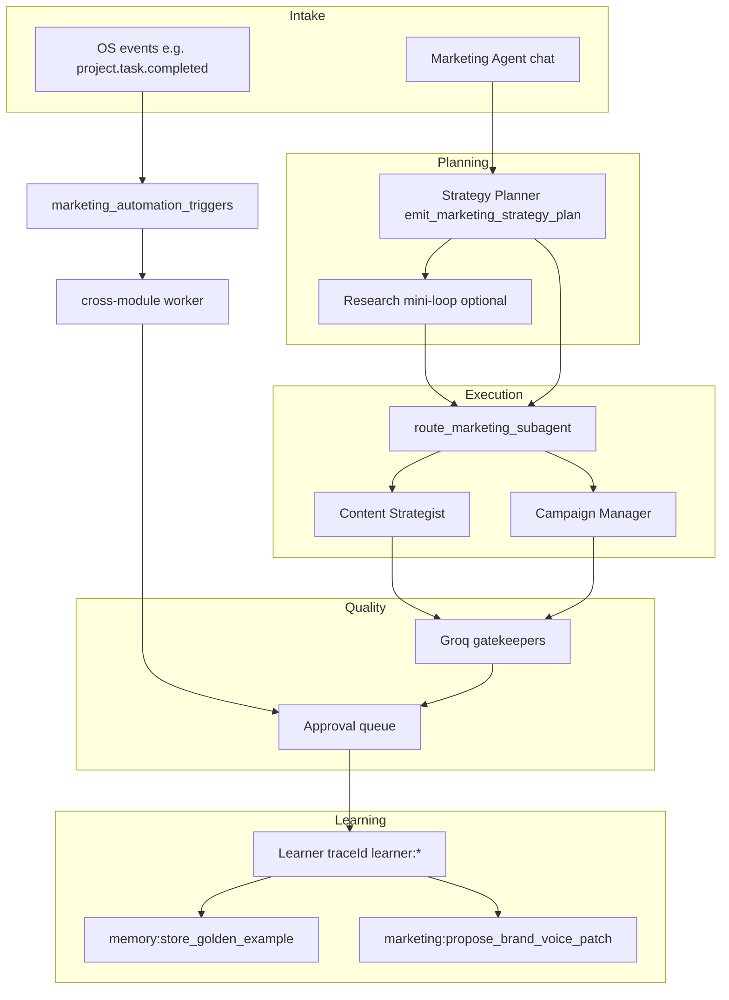

# Marketing Module V2 — Architecture

This document describes the Messign Marketing **V2** architecture: strategy-first loops, triggers, learning, and tool boundaries.

## System map

## Tool matrix

| Tool | Namespace | Chat-safe | Notes |
|------|------------|-----------|--------|
| `emit_marketing_strategy_plan` | planner | internal | Forced tool in planner step |
| `analytics:funnel_analysis` | analytics | yes | Lead funnel proxy |
| `analytics:experiment_design` | analytics | yes | A/B sizing heuristic |
| `seo:keyword_optimizer` | seo | yes | Heuristic, not live Google |
| `conversion:rate_simulator` | conversion | yes | Non-guarantee projections |
| `marketing:competitor_social_listen` | marketing | yes | DB intel + rate limit |
| `automation:manage_trigger` | automation | admin/manager | Persisted triggers |
| `memory:store_golden_example` | memory | **Learner only** | Rejects without `traceId` prefix `learner:` |
| `marketing:propose_brand_voice_patch` | marketing | HITL write | Inserts pending proposal row |

## Strategy-first research

When the planner emits a step with **`step_kind`: `research`**, the sub-orchestrator runs a **research mini-loop** (read-only tools, max 3 rounds) before Content/Campaign execution. See `planRequiresResearchPhase` in `strategyExecutionPlan.ts` and `RESEARCH_TOOL_NAMES` in `marketingAgentFlow.ts`.

## Autonomy guardrails

1. **Default HITL** for brand-impacting writes (`marketing:propose_brand_voice_patch` uses pending rows; live profile merge is manual).
2. **Triggers** use `marketing_automation_triggers`; event `project.task.completed` enqueues `marketing_automation_case_study_draft` when a matching trigger exists (`trigger_config.event_name = project.task.completed`).
3. **Learner** tools require `traceId` starting with `learner:` (except `NODE_ENV=test`).
4. **Rate limits** on `marketing:competitor_social_listen` (per org per hour).

## Related docs

- [email-design-pipeline.md](./email-design-pipeline.md) — VA2 manifest → Unlayer assembly (client)
- [marketing-perfect-agent-research-summary.md](./marketing-perfect-agent-research-summary.md)
- Server: `services/ai/marketing/marketingAgentFlow.ts`, `services/marketing/marketingAutomationTriggerService.ts`
